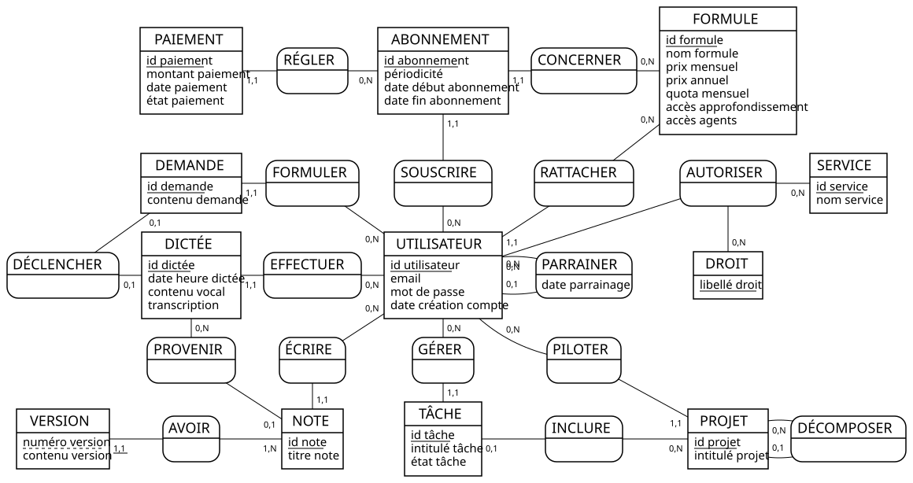

# ProjetDB_Ragot_Talfer

Mini-projet du module **TI503N – Bases de données 1 : concepts de base** (Efrei).
Conception d'une base de données avec la méthode **MERISE**.

**Binôme :** Emmanuel RAGOT · Tunui TALFER

## Sommaire
1. [Présentation du projet](#1-présentation-du-projet)
2. [Analyse des besoins](#2-analyse-des-besoins)
3. [Analyse des résultats de l'IA](#3-analyse-des-résultats-de-lia)
4. [MCD](#4-mcd)
5. [Organisation du dépôt](#5-organisation-du-dépôt)

---

## 1. Présentation du projet

Notre domaine : une **application de journal personnel à commande vocale**, proposée en SaaS sur téléphone et sur ordinateur.
L'utilisateur parle à l'application dès qu'une idée ou une tâche lui vient, même en vrac. L'application transcrit, reformule dans le style de ses notes précédentes, puis range chaque élément au bon endroit : note, tâche, projet ou agenda. Elle peut aussi agir pour lui sur les services qu'il a connectés (agenda, recherches).
L'application est gratuite dans la limite d'un quota mensuel. Des abonnements payants financent les serveurs et débloquent deux options : l'approfondissement des idées et des agents autonomes.

La base de données gère les comptes, les formules et abonnements, les paiements, les dictées et demandes, les notes et leurs versions, les tâches, les projets, les services connectés avec leurs droits, et le parrainage.

---

## 2. Analyse des besoins

### 2.1 Prompt final (v2)

Le prompt suit le framework **RICARDO** à partir de la base fournie : nous avons complété les parties à compléter (domaine, activité, exemples, données collectées, références) et ajouté des précisions sur le périmètre et sur le dictionnaire. Les autres paragraphes sont inchangés.
Toutes les versions sont dans [`prompts/`](prompts/) et les réponses brutes de l'IA dans [`reponses-ia/`](reponses-ia/).

```text
Tu travailles dans le domaine des SaaS, plus précisément sur les applications de prise de notes et d’assistance personnelle par intelligence artificielle.

Ton entreprise a comme activité de :
- proposer une application de journal personnel à commande vocale, sur téléphone et sur ordinateur.
L'utilisateur lui parle dès qu'une idée ou une tâche lui vient, même en vrac et dans le désordre.
- L'application retranscrit ce qui a été dit, puis le reformule avec la même présentation et le même ton que ses notes précédentes.
- Elle range ensuite chaque élément au bon endroit : une note, une tâche, un projet avec ses pistes à explorer, ou un événement de l'agenda.
(possibilité d'importer ses notes Apple existantes (ou autres notes) pour que l'application apprenne son style de réflexion et d'écriture)
- Elle peut aussi agir à sa place sur l'appareil : modifier l'emploi du temps, ajouter des tâches ou faire des recherches
(uniquement sur les services et avec les droits que l'utilisateur lui a accordés (lire, ajouter, modifier))
- l'entreprise est "non-profit", l'application est gratuite dans la limite d'un quota mensuel de dictées et de demandes.
   ->Chaque formule a un prix mensuel et un prix annuel (0 € pour la formule gratuite).
   ->Des abonnements payants, mensuels ou annuels, financent les serveurs et débloquent deux options :
        -l'approfondissement des idées (développer les pistes, proposer des hypothèses, entrer dans les détails);
        -agents autonomes qui découpent un projet en tâches et le font avancer sans intervention de l'utilisateur.

Ce qui n'est pas géré (initialement) :
- le travail en équipe,
- le partage de notes,
- les tâches de programmation (pas un codex ou un claude code),
- le fonctionnement interne des agents autonomes (géré par un outil externe : l'entreprise suit seulement qui a souscrit à cette option),
- les événements de l'agenda eux-mêmes : ils restent dans le service d'agenda connecté, l'application n'en garde pas de copie.

C’est une entreprise comme Notion (Notion AI), AudioPen, Voicenotes, Mem.

Les données ont été collectées sur les utilisateurs et leurs comptes, les formules, les abonnements et les paiements, les dictées et leur transcription, les demandes faites à l'application, les notes et leurs versions successives, les tâches, les projets et leurs sous-projets, les services connectés et les droits accordés à l'application, ainsi que le parrainage entre utilisateurs.

Pour le dictionnaire de données :
- chaque donnée correspond à une seule information (par exemple, le titre d'une note et l'intitulé d'une tâche sont deux données différentes, pas une seule) ;
- n'y mets pas les valeurs qui se calculent à partir d'autres données (par exemple le nombre de dictées utilisées dans le mois) ;
- vérifie le total avant de répondre : il doit rester entre 25 et 35 données ;
- réponds seulement avec les règles de gestion et le dictionnaire, sans commentaire sur les exemples cités.

Inspire-toi des sites web suivants : https://www.notion.com/product/ai ; https://audiopen.ai ; https://voicenotes.com ; https://mem.ai ; https://support.apple.com/fr-fr/guide/notes/welcome/mac.

Ton entreprise veut appliquer MERISE pour concevoir un système d'information. Tu es chargé de la partie analyse, c’est-à-dire de collecter les besoins auprès de l’entreprise. Elle a fait appel à un étudiant en ingénierie informatique pour réaliser ce projet, tu dois lui fournir les informations nécessaires pour qu’il applique ensuite lui-même les étapes suivantes de conception et développement de la base de données.

D’abord, établis les règles de gestions des données de ton entreprise, sous la forme d'une liste à puce. Elle doit correspondre aux informations que fournit quelqu’un qui connaît le fonctionnement de l’entreprise, mais pas comment se construit un système d’information.

Ensuite, à partir de ces règles, fournis un dictionnaire de données brutes avec les colonnes suivantes, regroupées dans un tableau : signification de la donnée, type, taille en nombre de caractères ou de chiffres. Il doit y avoir entre 25 et 35 données. Il sert à fournir des informations supplémentaires sur chaque donnée (taille et type) mais sans a priori sur comment les données vont être modélisées ensuite.

Fournis donc les règles de gestion et le dictionnaire de données.
```

### 2.2 Règles de gestion

Règles renvoyées par l'IA pour le prompt v2 (réponse brute : [`reponses-ia/v2.md`](reponses-ia/v2.md)).

- Un utilisateur possède un compte personnel identifié par une adresse e-mail et peut utiliser l’application sur téléphone et sur ordinateur.
- Un utilisateur est rattaché à une seule formule à la fois.
- Une formule possède un prix mensuel, un prix annuel et un quota mensuel de dictées ou de demandes.
- La formule gratuite a un prix mensuel et un prix annuel nuls.
- Une formule peut donner accès ou non à l’approfondissement des idées.
- Une formule peut donner accès ou non aux agents autonomes.
- Un utilisateur peut souscrire à une formule payante selon une périodicité mensuelle ou annuelle.
- Un abonnement possède une date de début et peut avoir une date de fin.
- Un abonnement payant donne lieu à des paiements ; un paiement possède un montant, une date et un état.
- Un utilisateur peut effectuer des dictées vocales depuis l’application.
- Une dictée correspond à un contenu vocal enregistré à une date donnée et peut être transcrite en texte.
- Une dictée peut être associée à une demande adressée à l’application.
- Une demande correspond à une instruction ou une requête formulée par l’utilisateur auprès de l’application.
- Une demande peut conduire l’application à produire ou modifier une note, une tâche, un projet, un sous-projet ou à effectuer une action sur un service connecté.
- Une note possède un titre, un contenu et peut évoluer au cours du temps.
- Chaque modification importante du contenu d’une note constitue une nouvelle version de cette note ; les versions précédentes sont conservées.
- Une note peut provenir d’une dictée ou d’un import de notes existantes.
- L’utilisateur peut importer des notes provenant d’un service de prise de notes afin que l’application dispose d’exemples de son style d’écriture et de réflexion.
- Une tâche possède un intitulé, un état et peut être associée à un projet.
- Un projet possède un intitulé et peut contenir des sous-projets destinés notamment à organiser les pistes à explorer.
- Un sous-projet appartient à un projet et possède lui-même un intitulé.
- L’application peut rechercher des informations à la demande de l’utilisateur.
- L’application peut agir sur des services externes uniquement lorsque l’utilisateur a accordé les droits nécessaires.
- Pour chaque service connecté, les droits accordés à l’application sont définis séparément pour la lecture, l’ajout et la modification.
- Une connexion à un service externe appartient à un utilisateur et concerne un service identifié.
- Les événements d’agenda restent dans le service d’agenda connecté et ne sont pas conservés comme données propres dans l’application.
- L’application peut toutefois recevoir une demande visant à consulter ou modifier l’agenda lorsque le service connecté et les droits accordés l’autorisent.
- L’approfondissement des idées permet, lorsque la formule de l’utilisateur l’autorise, de développer les pistes, formuler des hypothèses et approfondir le contenu d’une demande ou d’un projet.
- Les agents autonomes sont accessibles uniquement aux utilisateurs dont la formule autorise cette fonctionnalité ; ils peuvent découper un projet en tâches et faire progresser le projet sans intervention permanente de l’utilisateur.
- Le fonctionnement interne des agents autonomes est assuré par un outil externe et n’est pas géré dans le système d’information de l’entreprise.
- Un utilisateur peut parrainer un autre utilisateur ; une relation de parrainage associe un parrain et un filleul.
- Une relation de parrainage possède une date d’enregistrement.
- Une donnée personnelle ou un contenu produit par un utilisateur appartient à son espace personnel et n’est pas partagé avec d’autres utilisateurs dans le périmètre initial de l’application.
- L’application fonctionne selon un principe de quota : l’utilisation des dictées et demandes est limitée par la formule souscrite.

### 2.3 Dictionnaire de données (35 données)

Dictionnaire renvoyé par l'IA pour le prompt v2, **après retrait de 2 données en double** (voir [§3.3](#33-modifications-apportées)).

| # | Signification de la donnée | Type | Taille |
|---|---|---|---:|
| 1 | Identifiant de l’utilisateur | Entier | 10 chiffres |
| 2 | Adresse e-mail de l’utilisateur | Chaîne de caractères | 254 caractères |
| 3 | Mot de passe chiffré ou haché du compte | Chaîne de caractères | 255 caractères |
| 4 | Date de création du compte utilisateur | Date et heure | 19 caractères |
| 5 | Identifiant de la formule | Entier | 10 chiffres |
| 6 | Nom de la formule | Chaîne de caractères | 100 caractères |
| 7 | Prix mensuel de la formule | Nombre décimal | 8 chiffres |
| 8 | Prix annuel de la formule | Nombre décimal | 8 chiffres |
| 9 | Quota mensuel de la formule | Entier | 6 chiffres |
| 10 | Accès à l’approfondissement des idées | Booléen | 1 caractère |
| 11 | Accès aux agents autonomes | Booléen | 1 caractère |
| 12 | Identifiant de l’abonnement | Entier | 10 chiffres |
| 13 | Périodicité de l’abonnement | Chaîne de caractères | 10 caractères |
| 14 | Date de début de l’abonnement | Date et heure | 19 caractères |
| 15 | Date de fin de l’abonnement | Date et heure | 19 caractères |
| 16 | Identifiant du paiement | Entier | 10 chiffres |
| 17 | Montant du paiement | Nombre décimal | 8 chiffres |
| 18 | Date du paiement | Date et heure | 19 caractères |
| 19 | État du paiement | Chaîne de caractères | 20 caractères |
| 20 | Identifiant de la dictée | Entier | 10 chiffres |
| 21 | Date et heure de la dictée | Date et heure | 19 caractères |
| 22 | Contenu vocal de la dictée | Donnée binaire | 50 Mo |
| 23 | Transcription de la dictée | Texte | 65 535 caractères |
| 24 | Identifiant de la demande | Entier | 10 chiffres |
| 25 | Contenu de la demande adressée à l’application | Texte | 65 535 caractères |
| 26 | Identifiant de la note | Entier | 10 chiffres |
| 27 | Titre de la note | Chaîne de caractères | 500 caractères |
| 28 | Contenu de la note | Texte | 65 535 caractères |
| 29 | Numéro de version de la note | Entier | 6 chiffres |
| 30 | Intitulé de la tâche | Chaîne de caractères | 500 caractères |
| 31 | État de la tâche | Chaîne de caractères | 30 caractères |
| 32 | Intitulé du projet ou du sous-projet | Chaîne de caractères | 500 caractères |
| 33 | Nom du service connecté | Chaîne de caractères | 100 caractères |
| 34 | Droit accordé sur un service connecté | Chaîne de caractères | 20 caractères |
| 35 | Date d’enregistrement du parrainage | Date et heure | 19 caractères |

---

## 3. Analyse des résultats de l'IA

IA utilisée : **Luna 6** (réglage « moyen »), une nouvelle conversation à chaque version, prompt collé en entier.

### 3.1 Version 1

Réponse : [`reponses-ia/v1.md`](reponses-ia/v1.md)

| Problème relevé | Correction dans la v2 |
|---|---|
| **36 données**, au-dessus de la limite de 35 | Périmètre resserré (les événements de l'agenda restent dans l'agenda connecté) et rappel du total à vérifier |
| **7 données mélangent plusieurs informations** (« titre d'une note, tâche, d'un projet ou d'un événement », « contenu d'une note ou d'une version de note », « date de fin ou de renouvellement »…) | Consigne : une donnée = une seule information |
| **Donnée calculable** : « nombre de dictées utilisées pendant la période » se déduit des dictées | Consigne : pas de valeurs calculables |
| **Prix des formules absent**, alors que l'application vend des abonnements | Prix mensuel et annuel ajoutés au contexte |
| Commentaire sur les exemples cités, hors du rôle demandé | Consigne : répondre seulement avec les règles et le dictionnaire |

### 3.2 Version 2

Réponse : [`reponses-ia/v2.md`](reponses-ia/v2.md)

Tous les problèmes de la v1 sont corrigés, sauf le nombre de données : **37**.

| | v1 | v2 |
|---|---|---|
| Nombre de données | 36 | 37 |
| Données mélangeant plusieurs informations | 7 | 0 |
| Données calculables | 1 | 0 |
| Prix des formules | absent | présent |
| Commentaire hors rôle | oui | non |

Problèmes restants dans la v2 :
- « Identifiant de l'utilisateur parrain » et « Identifiant de l'utilisateur filleul » font **double emploi** avec « Identifiant de l'utilisateur » : un parrain et un filleul sont tous les deux des utilisateurs.
- La taille du « contenu vocal de la dictée » est donnée en **Mo**, alors que le prompt demande une taille en caractères ou en chiffres.

### 3.3 Modifications apportées

Comme le sujet l'autorise quand il reste trop de données après plusieurs essais, nous avons **retiré 2 données** du dictionnaire de la v2 :

| Donnée retirée | Raison |
|---|---|
| Identifiant de l'utilisateur parrain | Même information que « Identifiant de l'utilisateur » |
| Identifiant de l'utilisateur filleul | Même information que « Identifiant de l'utilisateur » |

Le parrainage reste décrit par la règle « une relation de parrainage associe un parrain et un filleul » et par la donnée « Date d'enregistrement du parrainage ». Le dictionnaire final compte **35 données**.

Nous n'avons pas modifié la taille du contenu vocal, puisque le sujet autorise seulement à retirer des données. Nous en tiendrons compte dans la suite du projet.

---

## 4. MCD

### 4.1 Schéma



### 4.2 Fichier source

Le MCD a été réalisé avec **Mocodo** (version 4.3.3) : [`mcd/journal.mcd`](mcd/journal.mcd).
Pour régénérer l'image : `mocodo --input journal.mcd` dans le dossier `mcd/`.

### 4.3 Correspondance dictionnaire → MCD

Chaque donnée du dictionnaire (§2.3) et sa place dans le MCD.

| # | Donnée | Entité ou association | Attribut |
|---|---|---|---|
| 1 | Identifiant de l’utilisateur | UTILISATEUR | id utilisateur |
| 2 | Adresse e-mail de l’utilisateur | UTILISATEUR | email |
| 3 | Mot de passe chiffré ou haché du compte | UTILISATEUR | mot de passe |
| 4 | Date de création du compte utilisateur | UTILISATEUR | date création compte |
| 5 | Identifiant de la formule | FORMULE | id formule |
| 6 | Nom de la formule | FORMULE | nom formule |
| 7 | Prix mensuel de la formule | FORMULE | prix mensuel |
| 8 | Prix annuel de la formule | FORMULE | prix annuel |
| 9 | Quota mensuel de la formule | FORMULE | quota mensuel |
| 10 | Accès à l’approfondissement des idées | FORMULE | accès approfondissement |
| 11 | Accès aux agents autonomes | FORMULE | accès agents |
| 12 | Identifiant de l’abonnement | ABONNEMENT | id abonnement |
| 13 | Périodicité de l’abonnement | ABONNEMENT | périodicité |
| 14 | Date de début de l’abonnement | ABONNEMENT | date début abonnement |
| 15 | Date de fin de l’abonnement | ABONNEMENT | date fin abonnement |
| 16 | Identifiant du paiement | PAIEMENT | id paiement |
| 17 | Montant du paiement | PAIEMENT | montant paiement |
| 18 | Date du paiement | PAIEMENT | date paiement |
| 19 | État du paiement | PAIEMENT | état paiement |
| 20 | Identifiant de la dictée | DICTÉE | id dictée |
| 21 | Date et heure de la dictée | DICTÉE | date heure dictée |
| 22 | Contenu vocal de la dictée | DICTÉE | contenu vocal |
| 23 | Transcription de la dictée | DICTÉE | transcription |
| 24 | Identifiant de la demande | DEMANDE | id demande |
| 25 | Contenu de la demande adressée à l’application | DEMANDE | contenu demande |
| 26 | Identifiant de la note | NOTE | id note |
| 27 | Titre de la note | NOTE | titre note |
| 28 | Contenu de la note | VERSION | contenu version |
| 29 | Numéro de version de la note | VERSION | numéro version |
| 30 | Intitulé de la tâche | TÂCHE | intitulé tâche |
| 31 | État de la tâche | TÂCHE | état tâche |
| 32 | Intitulé du projet ou du sous-projet | PROJET | intitulé projet |
| 33 | Nom du service connecté | SERVICE | nom service |
| 34 | Droit accordé sur un service connecté | DROIT | libellé droit |
| 35 | Date d’enregistrement du parrainage | PARRAINER (association) | date parrainage |

**Données ajoutées** par rapport au dictionnaire : `id tâche`, `id projet` et `id service`, les identifiants des entités TÂCHE, PROJET et SERVICE (le sujet autorise à ajouter des données).

### 4.4 Éléments de modélisation avancés

Le MCD contient les trois éléments avancés vus en cours.

| Élément | Où dans le MCD | Règle de gestion qui le justifie (§2.2) |
|---|---|---|
| **Association récursive** | **PARRAINER** : UTILISATEUR (rôle *parrain*, 0,N) → UTILISATEUR (rôle *filleul*, 0,1), avec la date du parrainage | « Un utilisateur peut parrainer un autre utilisateur ; une relation de parrainage associe un parrain et un filleul. » |
| **Association récursive** | **DÉCOMPOSER** : PROJET (rôle *projet parent*, 0,N) → PROJET (rôle *sous-projet*, 0,1) | « Un projet […] peut contenir des sous-projets » et « Un sous-projet appartient à un projet » |
| **Entité faible** | **VERSION**, identifiée par sa note + son numéro de version (association **AVOIR**, cardinalité 1,1 relative) | « Chaque modification importante du contenu d'une note constitue une nouvelle version de cette note ; les versions précédentes sont conservées. » |
| **Association ternaire** | **AUTORISER** : UTILISATEUR – SERVICE – DROIT | « Pour chaque service connecté, les droits accordés à l'application sont définis séparément pour la lecture, l'ajout et la modification. » |

**Pourquoi ces choix :**
- **Sous-projet = projet.** Un sous-projet a les mêmes informations qu'un projet (un intitulé, un propriétaire, des tâches). Une seule entité PROJET reliée à elle-même évite de dupliquer la structure. Un sous-projet n'a qu'un seul projet parent (0,1).
- **Version faible.** Un numéro de version (1, 2, 3…) n'a de sens qu'à l'intérieur de sa note, et une version n'existe pas sans sa note. VERSION n'a donc pas d'identifiant propre : elle est identifiée relativement à NOTE.
- **Ternaire plutôt que binaires.** Un droit n'a de sens que pour **un utilisateur, sur un service, pour un type d'action** à la fois. Deux utilisateurs peuvent accorder des droits différents sur le même service, et un utilisateur peut accorder la lecture sur son agenda mais pas la modification. Trois associations binaires ne permettraient pas de savoir quel droit va avec quel service pour quel utilisateur.

### 4.5 Normalisation (3FN)

- **1FN** : chaque attribut contient une seule valeur. Les droits ne sont pas stockés sous forme de liste (« lecture, ajout ») : chaque droit accordé est une occurrence de AUTORISER.
- **2FN** : seule VERSION a un identifiant composé (note + numéro de version). Son seul attribut, `contenu version`, dépend bien des deux à la fois.
- **3FN** : aucun attribut ne dépend d'un autre attribut non identifiant.
  - Les prix, le quota et les options sont dans FORMULE, pas dans ABONNEMENT ni dans UTILISATEUR.
  - Le montant d'un paiement est dans PAIEMENT : il peut différer du prix de la formule (paiement partiel, remboursement).
  - Aucune donnée calculable n'est stockée : le nombre de dictées et de demandes utilisées dans le mois se calcule en comptant les DICTÉE et les DEMANDE de l'utilisateur.
  - RATTACHER et ABONNEMENT ne font pas double emploi : RATTACHER donne la formule **actuelle** de chaque utilisateur, y compris la formule gratuite, qui ne donne lieu à aucun abonnement ; ABONNEMENT garde l'**historique** des souscriptions payantes (périodicité, dates, paiements).

---

## 5. Organisation du dépôt

```
ProjetDB_Ragot_Talfer/
├── README.md        ← ce fichier
├── prompts/         ← toutes les versions du prompt (v1, v2)
├── reponses-ia/     ← réponse brute de l'IA pour chaque version
└── mcd/             ← fichier source Mocodo (journal.mcd) et image (journal_static.svg) du MCD
```
