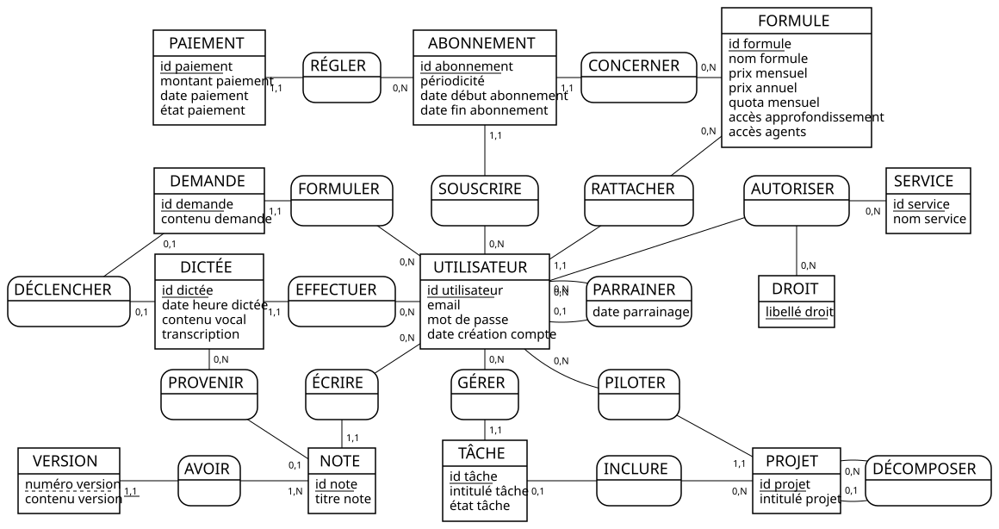
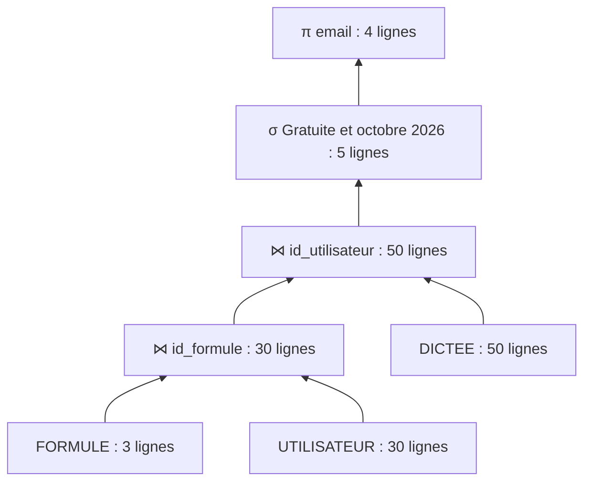
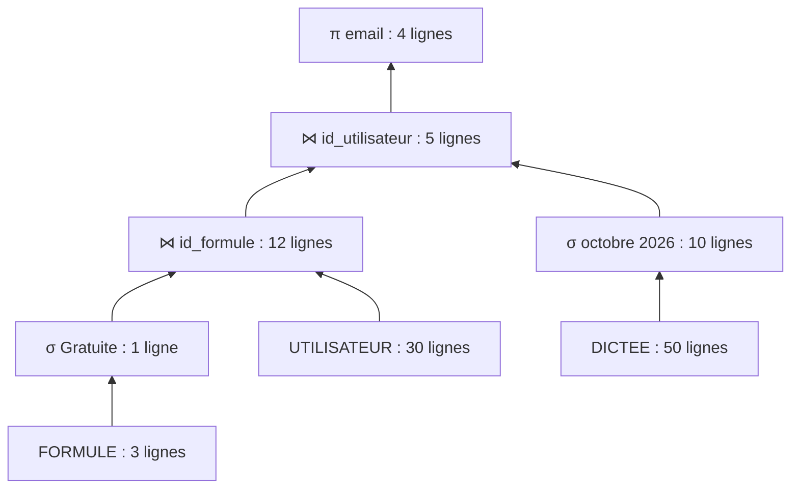

# ProjetDB_Ragot_Talfer

Mini-projet de Bases de données 1 : conception d'une base de données avec la méthode MERISE, puis création et interrogation sous MySQL.

Binôme : Emmanuel RAGOT et Tunui TALFER

## 1. Présentation du projet

Le problème : on a parfois des idées passagères, mais élaborées et complexes, qui arrivent à un moment où l'on n'a pas le temps de s'arrêter pour les écrire dans ses notes. Faute de temps, elles sont oubliées, ou notées trop vite pour être réutilisables ensuite. Avec notre application, il suffit de l'ouvrir et de parler, en expliquant tout dans le désordre : le journal se charge de formaliser chaque idée et de la ranger là où elle doit aller (modifier l'emploi du temps, créer un nouveau projet avec des pistes à explorer, etc.).

Notre domaine est donc une application de journal personnel à commande vocale, sur téléphone et sur ordinateur. L'utilisateur parle à l'application, elle transcrit, reformule dans le style de ses notes, puis range chaque élément dans une note, une tâche, un projet ou l'agenda. Elle peut aussi agir sur les services qu'il a connectés (agenda, Notion, Obsidian...).

L'application est gratuite dans la limite d'un quota par mois. Des abonnements payants financent les serveurs et donnent accès à deux options : l'approfondissement des idées et des agents autonomes.

La base de données gère les comptes, les formules, les abonnements et les paiements, les dictées et les demandes, les notes et leurs versions, les tâches et les projets, les services connectés avec leurs droits, et le parrainage.

## 2. Analyse des besoins

### 2.1 Prompt final (v2)

On est partis de la base de prompt fournie (framework RICARDO). On a complété les parties à compléter (domaine, activité, exemples, données collectées, références) et ajouté quelques précisions sur le périmètre et sur le dictionnaire. Toutes les versions sont dans `prompts/` et les réponses de l'IA dans `reponses-ia/`.

```text
Tu travailles dans le domaine des SaaS, plus précisément sur les applications de prise de notes et d’assistance personnelle par intelligence artificielle.

Ton entreprise a comme activité de :
- proposer une application de journal personnel à commande vocale, sur téléphone et sur ordinateur.
L'utilisateur lui parle dès qu'une idée ou une tâche lui vient, même en vrac et dans le désordre.
- L'application retranscrit ce qui a été dit, puis le reformule avec la même présentation et le même ton que ses notes précédentes.
- Elle range ensuite chaque élément au bon endroit : une note, une tâche, un projet avec ses pistes à explorer, ou un événement de l'agenda.
(possibilité d'importer ses notes Apple existantes (ou autres notes) pour que l'application apprenne son style de réflexion et d'écriture)
- Elle peut aussi agir à sa place sur l'appareil : modifier l'emploi du temps, ajouter des tâches ou faire des recherches
(uniquement sur les services et avec les droits que l'utilisateur lui a accordés (lire, ajouter, modifier))
- l'entreprise est "non-profit", l'application est gratuite dans la limite d'un quota mensuel de dictées et de demandes.
   ->Chaque formule a un prix mensuel et un prix annuel (0 € pour la formule gratuite).
   ->Des abonnements payants, mensuels ou annuels, financent les serveurs et débloquent deux options :
        -l'approfondissement des idées (développer les pistes, proposer des hypothèses, entrer dans les détails);
        -agents autonomes qui découpent un projet en tâches et le font avancer sans intervention de l'utilisateur.

Ce qui n'est pas géré (initialement) :
- le travail en équipe,
- le partage de notes,
- les tâches de programmation (pas un codex ou un claude code),
- le fonctionnement interne des agents autonomes (géré par un outil externe : l'entreprise suit seulement qui a souscrit à cette option),
- les événements de l'agenda eux-mêmes : ils restent dans le service d'agenda connecté, l'application n'en garde pas de copie.

C’est une entreprise comme Notion (Notion AI), AudioPen, Voicenotes, Mem.

Les données ont été collectées sur les utilisateurs et leurs comptes, les formules, les abonnements et les paiements, les dictées et leur transcription, les demandes faites à l'application, les notes et leurs versions successives, les tâches, les projets et leurs sous-projets, les services connectés et les droits accordés à l'application, ainsi que le parrainage entre utilisateurs.

Pour le dictionnaire de données :
- chaque donnée correspond à une seule information (par exemple, le titre d'une note et l'intitulé d'une tâche sont deux données différentes, pas une seule) ;
- n'y mets pas les valeurs qui se calculent à partir d'autres données (par exemple le nombre de dictées utilisées dans le mois) ;
- vérifie le total avant de répondre : il doit rester entre 25 et 35 données ;
- réponds seulement avec les règles de gestion et le dictionnaire, sans commentaire sur les exemples cités.

Inspire-toi des sites web suivants : https://www.notion.com/product/ai ; https://audiopen.ai ; https://voicenotes.com ; https://mem.ai ; https://support.apple.com/fr-fr/guide/notes/welcome/mac.

Ton entreprise veut appliquer MERISE pour concevoir un système d'information. Tu es chargé de la partie analyse, c’est-à-dire de collecter les besoins auprès de l’entreprise. Elle a fait appel à un étudiant en ingénierie informatique pour réaliser ce projet, tu dois lui fournir les informations nécessaires pour qu’il applique ensuite lui-même les étapes suivantes de conception et développement de la base de données.

D’abord, établis les règles de gestions des données de ton entreprise, sous la forme d'une liste à puce. Elle doit correspondre aux informations que fournit quelqu’un qui connaît le fonctionnement de l’entreprise, mais pas comment se construit un système d’information.

Ensuite, à partir de ces règles, fournis un dictionnaire de données brutes avec les colonnes suivantes, regroupées dans un tableau : signification de la donnée, type, taille en nombre de caractères ou de chiffres. Il doit y avoir entre 25 et 35 données. Il sert à fournir des informations supplémentaires sur chaque donnée (taille et type) mais sans a priori sur comment les données vont être modélisées ensuite.

Fournis donc les règles de gestion et le dictionnaire de données.
```

### 2.2 Règles de gestion

Règles renvoyées par l'IA pour le prompt v2 (réponse complète dans `reponses-ia/v2.md`) :

- Un utilisateur possède un compte personnel identifié par une adresse e-mail et peut utiliser l’application sur téléphone et sur ordinateur.
- Un utilisateur est rattaché à une seule formule à la fois.
- Une formule possède un prix mensuel, un prix annuel et un quota mensuel de dictées ou de demandes.
- La formule gratuite a un prix mensuel et un prix annuel nuls.
- Une formule peut donner accès ou non à l’approfondissement des idées.
- Une formule peut donner accès ou non aux agents autonomes.
- Un utilisateur peut souscrire à une formule payante selon une périodicité mensuelle ou annuelle.
- Un abonnement possède une date de début et peut avoir une date de fin.
- Un abonnement payant donne lieu à des paiements ; un paiement possède un montant, une date et un état.
- Un utilisateur peut effectuer des dictées vocales depuis l’application.
- Une dictée correspond à un contenu vocal enregistré à une date donnée et peut être transcrite en texte.
- Une dictée peut être associée à une demande adressée à l’application.
- Une demande correspond à une instruction ou une requête formulée par l’utilisateur auprès de l’application.
- Une demande peut conduire l’application à produire ou modifier une note, une tâche, un projet, un sous-projet ou à effectuer une action sur un service connecté.
- Une note possède un titre, un contenu et peut évoluer au cours du temps.
- Chaque modification importante du contenu d’une note constitue une nouvelle version de cette note ; les versions précédentes sont conservées.
- Une note peut provenir d’une dictée ou d’un import de notes existantes.
- L’utilisateur peut importer des notes provenant d’un service de prise de notes afin que l’application dispose d’exemples de son style d’écriture et de réflexion.
- Une tâche possède un intitulé, un état et peut être associée à un projet.
- Un projet possède un intitulé et peut contenir des sous-projets destinés notamment à organiser les pistes à explorer.
- Un sous-projet appartient à un projet et possède lui-même un intitulé.
- L’application peut rechercher des informations à la demande de l’utilisateur.
- L’application peut agir sur des services externes uniquement lorsque l’utilisateur a accordé les droits nécessaires.
- Pour chaque service connecté, les droits accordés à l’application sont définis séparément pour la lecture, l’ajout et la modification.
- Une connexion à un service externe appartient à un utilisateur et concerne un service identifié.
- Les événements d’agenda restent dans le service d’agenda connecté et ne sont pas conservés comme données propres dans l’application.
- L’application peut toutefois recevoir une demande visant à consulter ou modifier l’agenda lorsque le service connecté et les droits accordés l’autorisent.
- L’approfondissement des idées permet, lorsque la formule de l’utilisateur l’autorise, de développer les pistes, formuler des hypothèses et approfondir le contenu d’une demande ou d’un projet.
- Les agents autonomes sont accessibles uniquement aux utilisateurs dont la formule autorise cette fonctionnalité ; ils peuvent découper un projet en tâches et faire progresser le projet sans intervention permanente de l’utilisateur.
- Le fonctionnement interne des agents autonomes est assuré par un outil externe et n’est pas géré dans le système d’information de l’entreprise.
- Un utilisateur peut parrainer un autre utilisateur ; une relation de parrainage associe un parrain et un filleul.
- Une relation de parrainage possède une date d’enregistrement.
- Une donnée personnelle ou un contenu produit par un utilisateur appartient à son espace personnel et n’est pas partagé avec d’autres utilisateurs dans le périmètre initial de l’application.
- L’application fonctionne selon un principe de quota : l’utilisation des dictées et demandes est limitée par la formule souscrite.

### 2.3 Dictionnaire de données (35 données)

Dictionnaire renvoyé par l'IA pour le prompt v2, après avoir retiré 2 données en double (voir 3.3).

| # | Signification de la donnée | Type | Taille |
|---|---|---|---:|
| 1 | Identifiant de l’utilisateur | Entier | 10 chiffres |
| 2 | Adresse e-mail de l’utilisateur | Chaîne de caractères | 254 caractères |
| 3 | Mot de passe chiffré ou haché du compte | Chaîne de caractères | 255 caractères |
| 4 | Date de création du compte utilisateur | Date et heure | 19 caractères |
| 5 | Identifiant de la formule | Entier | 10 chiffres |
| 6 | Nom de la formule | Chaîne de caractères | 100 caractères |
| 7 | Prix mensuel de la formule | Nombre décimal | 8 chiffres |
| 8 | Prix annuel de la formule | Nombre décimal | 8 chiffres |
| 9 | Quota mensuel de la formule | Entier | 6 chiffres |
| 10 | Accès à l’approfondissement des idées | Booléen | 1 caractère |
| 11 | Accès aux agents autonomes | Booléen | 1 caractère |
| 12 | Identifiant de l’abonnement | Entier | 10 chiffres |
| 13 | Périodicité de l’abonnement | Chaîne de caractères | 10 caractères |
| 14 | Date de début de l’abonnement | Date et heure | 19 caractères |
| 15 | Date de fin de l’abonnement | Date et heure | 19 caractères |
| 16 | Identifiant du paiement | Entier | 10 chiffres |
| 17 | Montant du paiement | Nombre décimal | 8 chiffres |
| 18 | Date du paiement | Date et heure | 19 caractères |
| 19 | État du paiement | Chaîne de caractères | 20 caractères |
| 20 | Identifiant de la dictée | Entier | 10 chiffres |
| 21 | Date et heure de la dictée | Date et heure | 19 caractères |
| 22 | Contenu vocal de la dictée | Donnée binaire | 50 Mo |
| 23 | Transcription de la dictée | Texte | 65 535 caractères |
| 24 | Identifiant de la demande | Entier | 10 chiffres |
| 25 | Contenu de la demande adressée à l’application | Texte | 65 535 caractères |
| 26 | Identifiant de la note | Entier | 10 chiffres |
| 27 | Titre de la note | Chaîne de caractères | 500 caractères |
| 28 | Contenu de la note | Texte | 65 535 caractères |
| 29 | Numéro de version de la note | Entier | 6 chiffres |
| 30 | Intitulé de la tâche | Chaîne de caractères | 500 caractères |
| 31 | État de la tâche | Chaîne de caractères | 30 caractères |
| 32 | Intitulé du projet ou du sous-projet | Chaîne de caractères | 500 caractères |
| 33 | Nom du service connecté | Chaîne de caractères | 100 caractères |
| 34 | Droit accordé sur un service connecté | Chaîne de caractères | 20 caractères |
| 35 | Date d’enregistrement du parrainage | Date et heure | 19 caractères |

## 3. Analyse des résultats de l'IA

IA utilisée : Luna 6 (réglage moyen), avec une nouvelle conversation à chaque version et le prompt collé en entier.

### 3.1 Version 1 (`reponses-ia/v1.md`)

Problèmes relevés :  
-> 36 données, alors que la limite est 35.  
-> 7 données mélangent plusieurs informations, par exemple "titre d'une note, tâche, d'un projet ou d'un événement".  
-> Une donnée se calcule à partir des autres : le nombre de dictées utilisées pendant la période.  
-> Les prix des formules n'apparaissent pas, alors que l'application vend des abonnements.  
-> L'IA commente les exemples cités, ce qu'on ne lui demandait pas.  

Pour la v2, on a précisé dans le prompt : une donnée = une seule information, pas de valeurs calculables, vérifier le total, répondre seulement avec les règles et le dictionnaire. On a aussi ajouté les prix des formules dans le contexte et sorti les événements de l'agenda du périmètre.

### 3.2 Version 2 (`reponses-ia/v2.md`)

Les problèmes de la v1 sont corrigés, sauf le nombre de données qui passe à 37. Il reste aussi deux défauts :  
-> "Identifiant de l'utilisateur parrain" et "Identifiant de l'utilisateur filleul" font double emploi avec "Identifiant de l'utilisateur", puisqu'un parrain et un filleul sont des utilisateurs.  
-> La taille du contenu vocal est donnée en Mo, alors que le prompt demande des caractères ou des chiffres.  

### 3.3 Modifications apportées

Comme le sujet l'autorise, on a retiré du dictionnaire les 2 données en double (identifiant du parrain et identifiant du filleul). Le parrainage reste décrit par sa règle de gestion et par la date du parrainage. Le dictionnaire final a donc 35 données.

On n'a pas modifié la taille du contenu vocal, puisque le sujet autorise seulement à retirer des données. Dans la base, on stocke donc seulement le chemin du fichier audio (`chemin_audio`).

## 4. MCD



Le MCD a été fait avec Mocodo, le fichier source est `mcd/journal.mcd`.

Éléments de cours :  
-> deux associations récursives : PARRAINER (un utilisateur parraine un autre utilisateur) et DÉCOMPOSER (un projet contient des sous-projets). Un sous-projet a les mêmes informations qu'un projet, donc on n'a pas fait d'entité à part.  
-> une entité faible : VERSION. Un numéro de version n'a de sens que dans sa note, donc une version est identifiée par sa note et son numéro.  
-> une association ternaire : AUTORISER, entre UTILISATEUR, SERVICE et DROIT. Un droit (lecture, ajout ou modification) n'a de sens que pour un utilisateur et un service en même temps. Avec trois associations binaires, on ne saurait plus quel droit va avec quel service pour quel utilisateur.  

## 5. MLD

Avec les règles de transformation du cours (clés primaires soulignées et clés étrangères avec un #) :

-> formule (<u>id_formule</u>, nom_formule, prix_mensuel, prix_annuel, quota_mensuel, acces_approfondissement, acces_agents)  
-> service (<u>id_service</u>, nom_service)  
-> utilisateur (<u>id_utilisateur</u>, email, mot_de_passe, date_creation_compte, #id_formule)  
-> parrainer (<u>#id_filleul</u>, #id_parrain, date_parrainage) (id_filleul et id_parrain font référence à utilisateur)  
-> abonnement (<u>id_abonnement</u>, periodicite, date_debut, date_fin, #id_formule, #id_utilisateur)  
-> paiement (<u>id_paiement</u>, montant, date_paiement, etat_paiement, #id_abonnement)  
-> dictee (<u>id_dictee</u>, date_heure_dictee, chemin_audio, transcription, #id_utilisateur)  
-> demande (<u>id_demande</u>, contenu_demande, #id_utilisateur, #id_dictee)  
-> note (<u>id_note</u>, titre_note, #id_dictee, #id_utilisateur)  
-> version_note (<u>#id_note, numero_version</u>, contenu_version)  
-> projet (<u>id_projet</u>, intitule_projet, #id_utilisateur)  
-> decomposer (<u>#id_sous_projet</u>, #id_projet_parent) (les deux font référence à projet)  
-> tache (<u>id_tache</u>, intitule_tache, etat_tache, #id_utilisateur, #id_projet)  
-> autoriser (<u>#id_utilisateur, #id_service, libelle_droit</u>)  

PARRAINER et DÉCOMPOSER sont devenues des tables : on avait d'abord mis une clé étrangère vers la même table (`id_parrain` dans utilisateur), mais MySQL refusait le ON UPDATE CASCADE dessus.

## 6. Insertion des données

Le prompt est dans `prompts/insertion_v1.txt` (même forme que celui du TP1). Les données ont été générées avec Claude (Anthropic) et sont dans `sql/3_insertion.sql`.

## 7. Scénario d'utilisation

Camille travaille au marketing. Elle prépare une campagne pour faire passer des utilisateurs de la formule Gratuite à Plus ou à Pro, puisque ce sont les abonnements qui paient les serveurs.

Elle a besoin de :  
-> savoir combien il y a d'utilisateurs par formule, et avoir la liste des e-mails des utilisateurs Gratuit ;  
-> trouver les utilisateurs Gratuit les plus actifs, qui sont les meilleurs candidats ;  
-> trouver ceux qui n'ont jamais payé et les anciens abonnés ;  
-> relancer les paiements échoués ou en attente ;  
-> récompenser les parrains qui ont le plus de filleuls ;  
-> voir quels services sont les plus connectés et le chiffre d'affaires par mois.

Les requêtes correspondantes sont dans `sql/4_interrogation.sql`.

## 8. Étude des plans d'exécution

Requête étudiée (la dernière de `4_interrogation.sql`) : les e-mails des utilisateurs Gratuit qui ont dicté en octobre 2026.

```sql
SELECT DISTINCT u.email
FROM formule f
INNER JOIN utilisateur u ON u.id_formule = f.id_formule
INNER JOIN dictee d ON d.id_utilisateur = u.id_utilisateur
WHERE f.nom_formule = 'Gratuite'
  AND d.date_heure_dictee BETWEEN '2026-10-01' AND '2026-10-31 23:59:59';
```

Elle utilise trois opérateurs : sélection (σ), jointure (⋈) et projection (π).

On compte les instructions comme au TD3 (exercice 6) : une jointure entre deux tables de n1 et n2 lignes coûte n1 × n2, une sélection ou une projection coûte le nombre de lignes parcourues. Tailles des tables : formule 3 lignes, utilisateur 30 lignes, dictee 50 lignes. Les nombres de lignes après chaque opérateur ont été mesurés sur nos données.

### Plan 1 : les jointures d'abord



| Étape | Calcul | Instructions | Lignes |
|---|---|---|---|
| utilisateur ⋈ formule | 30 × 3 | 90 | 30 |
| ⋈ dictee | 30 × 50 | 1 500 | 50 |
| σ Gratuite et octobre | 50 | 50 | 5 |
| π email | 5 | 5 | 4 |
| Total | | 1 645 | |

### Plan 2 : les sélections d'abord



| Étape | Calcul | Instructions | Lignes |
|---|---|---|---|
| σ Gratuite sur formule | 3 | 3 | 1 |
| σ octobre sur dictee | 50 | 50 | 10 |
| σ(formule) ⋈ utilisateur | 1 × 30 | 30 | 12 |
| ⋈ σ(dictee) | 12 × 10 | 120 | 5 |
| π email | 5 | 5 | 4 |
| Total | | 208 | |

### Conclusion

Le plan 2 est le meilleur : 208 instructions au lieu de 1 645, pour le même résultat (4 e-mails). La différence vient surtout de la deuxième jointure, qui croise 12 × 10 lignes au lieu de 30 × 50. Il vaut donc mieux faire les sélections avant les jointures.
